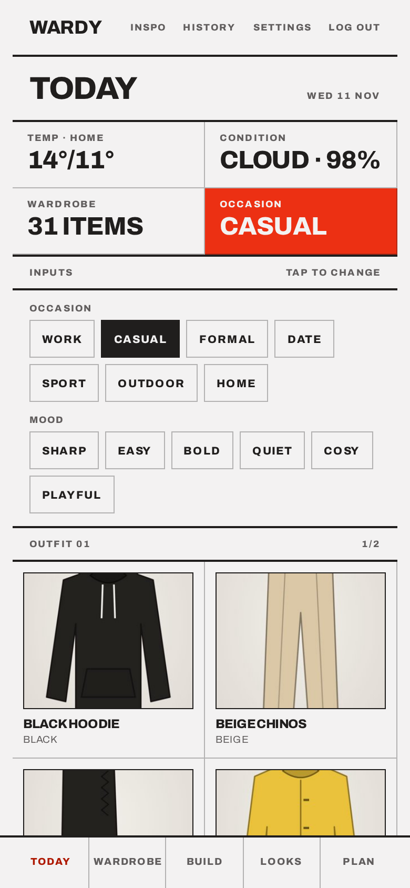
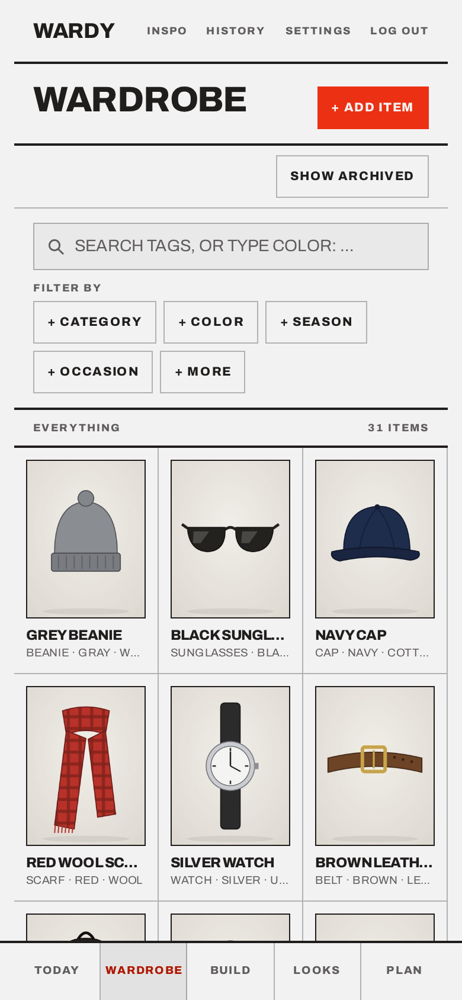
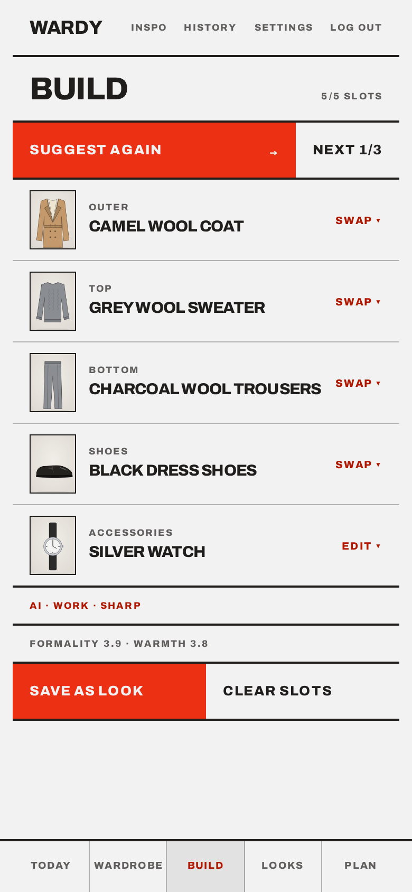
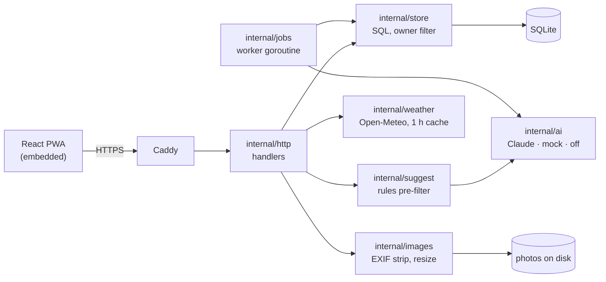

# Wardy

A self-hosted digital wardrobe and lookbook. Photograph your clothes, let AI
tag them, and get outfit suggestions for the weather, occasion and mood. Save
outfits as "looks" and log what you actually wore.

In daily use by a two-person household since summer 2026, running as one Go
binary on a 4 GB VPS.

<p align="center">
  
  
  
</p>

<sub>Screenshots from a local instance with the bundled sample garments and the
mock AI provider.</sub>

## Highlights

- **One static binary.** Go with `CGO_ENABLED=0`, the pure-Go SQLite driver,
  and the React frontend and SQL migrations embedded with `go:embed`. Deploying
  is copying one file and restarting a systemd unit. A running instance uses
  about 20 MB of memory.
- **AI on top, never underneath.** Outfits come from a deterministic rules
  filter (formality ranges, warmth against the forecast, recently worn). The
  LLM only picks and explains combinations from those candidates. When the AI
  is down or over budget, the app falls back to rules-only suggestions. When
  the weather service is down, it suggests anyway.
- **The model's output is checked like user input.** Tags must belong to closed
  vocabularies. Every item id the model returns must exist, belong to the user
  and come from the candidate set; outfits that fail are dropped, not rendered
  as broken cards.
- **Costs have hard limits.** Every API call is logged with its cost. There is
  a monthly budget, per-user daily caps, `max_tokens` on every request, at most
  3 retries, and prompt caching. Photos are tagged from a small thumbnail by
  the cheapest model (about $0.003 per item).
- **Privacy basics.** EXIF data (including GPS) is stripped from every upload.
  Every query that touches user data filters by owner in the storage layer.
  SQL is parameterized only, login is rate-limited, and free-text prompts are
  length-capped and passed to the model as data.

## Features

- **Today**: an outfit for today's weather (where you are, or home), occasion
  and mood. Swipe for the next one; save it as a look or log it as worn.
- **Wardrobe**: photo grid with structured search (`color:`, `category:`…
  as chips). New photos are tagged by AI in the background, then reviewed with
  pickers only. Archive, delete, "never worn", add to Build.
- **Build**: fill the outfit slots by hand, or tap SUGGEST OUTFIT with an
  occasion, mood and a request in your own words ("a fit with a red top").
  Every slot stays swappable.
- **Looks** and **Plan**: saved outfits, and a week to put them on.
- **History**: wear log and "not worn in a while".
- **Inspo**: photos of other people's outfits, tagged into a style profile
  that can steer suggestions, plus a style radar comparing what you own, what
  you wear and what you save.
- **Login**: Authelia single sign-on with password fallback, no public
  signup. Installable as a PWA.

## Architecture



- Handlers never write SQL, and the storage layer never imports HTTP.
- Background work (AI tagging, style summaries) runs from a `jobs` table and
  one worker goroutine, with no Redis and no second process. Jobs are
  idempotent and back off exponentially.
- Photos are rotated using their EXIF orientation, then saved as display
  (~1600 px) and thumbnail (~400 px) copies. Grids load only the thumbnails.
- `internal/ai` is the codebase's one deliberate abstraction: a provider
  interface with three implementations (Anthropic, a mock for development and
  tests, and off).

## Testing

`make test` runs the Go suite (50+ test files). The tests target the bugs that
fail without raising an error:

1. **Ownership**: user A can't read, edit or delete user B's items.
2. **AI response parsing**: recorded fixtures with malformed JSON,
   out-of-vocabulary values and hallucinated ids. Tests never call a live API.
3. **Outfit pre-filter**: a fixture wardrobe must give the right candidates for
   a given weather and occasion.
4. **Image pipeline**: EXIF is stripped, orientation is correct, and the
   output sizes are right.
5. **Enum validators**: table-driven tests that reject every invalid value.

Handlers are covered by integration tests with `httptest`.

## Stack

- **Backend**: Go 1.26, stdlib `net/http`, `modernc.org/sqlite`,
  `golang.org/x/image`, `log/slog`.
- **Frontend**: React, TypeScript, Vite, TanStack Query, Tailwind.
- **AI**: Claude Haiku for tagging, Claude Sonnet for suggestions.
- **Deploy**: binary + systemd + Caddy on a Hetzner VPS (no Docker in
  production). Merging to `main` deploys within a few minutes: build, database
  backup, restart, health check. See [`docs/deployment.md`](docs/deployment.md).

## Run it locally

```bash
cp .env.example .env                      # AI_PROVIDER=mock, so no API key needed
make dev                                  # Go :8080 + Vite :5173
./wardrobe create-user --email me@local
./wardrobe seed-samples --email me@local  # optional: ~30 tagged sample garments
```

There's no public signup; accounts are created from the CLI.

## How it was built

Built in phases, each usable before the next started: skeleton, auth, items
and photos, manual tagging, AI tagging, weather, the rules filter, LLM
suggestions, looks, wear history, and finally the PWA. The rules filter came
before the LLM on purpose, because it is also the permanent fallback.

Development used Claude Code as a pair programmer. [`CLAUDE.md`](CLAUDE.md)
sets out the constraints, layering, test priorities and build order that the
work followed, and [`docs/`](docs) holds the design notes for each area:

| Area | Notes |
|---|---|
| Tagging, filtering, item attributes | [`docs/taxonomy.md`](docs/taxonomy.md) |
| Schema, ownership, migrations | [`docs/data-model.md`](docs/data-model.md) |
| Tagging jobs, suggestions, AI budget | [`docs/ai.md`](docs/ai.md) |
| Login, uploads, the worker | [`docs/backend.md`](docs/backend.md) |
| UI, PWA, camera capture | [`docs/frontend.md`](docs/frontend.md) |
| Local setup and deployment | [`docs/deployment.md`](docs/deployment.md) |

## Non-goals

Social features, sharing, e-commerce, native mobile apps, background
removal, multi-tenancy, billing, Kubernetes, local LLM hosting.

## License

[MIT](LICENSE)
